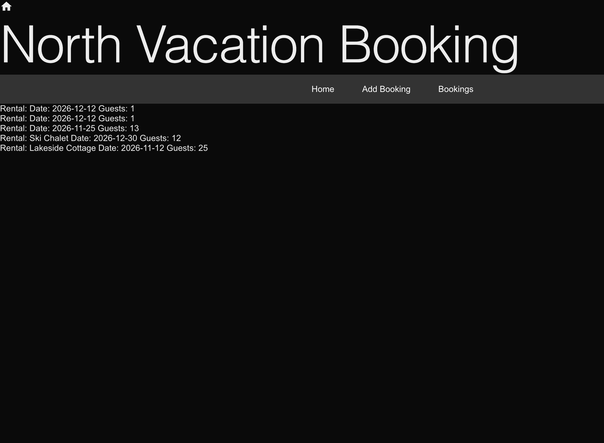

# Learning Practice: Defect Management

**Course:** AD 361 — Software Testing  
**Application:** North Vacation Booking  
**Testing approach:** Manual black-box testing through the user interface  
**Date reported:** November 22, 2026  
**Reporter:** Victoria Salomon

## Overview

This learning practice identifies, classifies, and documents unexpected behavior in the North Vacation Booking application. Tests compare the application's observed behavior with the provided requirements. Findings are documented without assuming access to, or knowledge of, the implementation code.

### Requirements

- Reservations must include **1–12 guests**.
- Reservations must last **1–31 nights**.
- Check-in must occur **before** checkout.
- All requested nights must be available.
- Valid reservations must include a **one-time $50 cleaning fee**.
- Invalid information must produce an error.

## Step 1 — Classify the Findings

| Finding | Classification | Explanation |
| --- | --- | --- |
| **1. Reservations can be saved with 13 or more guests** | **Product defect (NVB-001)** | The application accepts and saves a booking with 13 guests, even though the limit is 12. This directly violates the guest-count requirement and invalid-input validation requirement. |
| **2. The booking form provides only one date field** | **Product defect (NVB-002)** | There is no visible separate checkout field or stay-duration control. The user can proceed with one selected date, so they cannot specify a 1–31-night range or explicitly establish that check-in is before checkout. |
| **3. The “More” and “Save” buttons on rental cards do not respond** | **Requires further investigation** | These controls appear interactive but do not produce an observed action. Their intended behavior must be confirmed because it is not described in the supplied booking requirements. |
| **4. There are no booking-management actions beyond creating and viewing bookings** | **Requested change, not a confirmed defect** | The documented application scope includes creating and viewing reservations. Additional actions would require new requirements. |

**Expected behavior observed:** The application rejects a guest count of zero and displays a required-field error if no date is selected. These observations are *passes* for their respective validations, not defects.

## Step 2 — Defect Report

### NVB-001 — Application saves reservations with more than 12 guests

| Field | Information |
| --- | --- |
| **Defect ID** | NVB-001 |
| **Title** | Application saves a reservation with 13 guests, exceeding the allowed maximum |
| **Date Reported** | November 22, 2026 |
| **Reporter** | Victoria Salomon |
| **Application or Feature** | North Vacation Booking — Add Booking / guest-count validation |
| **Test Environment** | Local application in a desktop web browser; `http://localhost:5173/bookings/add` |
| **Preconditions** | Application is running; Add Booking form is accessible; a rental and date can be selected. |
| **Steps to Reproduce** | See numbered steps below. |
| **Expected Result** | A reservation must have 1–12 guests. A submission with 13 guests must be rejected, with appropriate validation, and must not be saved. |
| **Actual Result** | The form permits 13 guests; after confirming the booking, the application saves it, and the Bookings list shows a reservation with 13 guests. |
| **Severity** | **High** — a core business rule is violated and invalid reservation data is saved. |
| **Priority** | **High** — fix before the next release to prevent invalid bookings. |
| **Initial Status** | **New / Open** |
| **Related Requirement / Test Case** | Guests must be 1–12; invalid information must produce an error. Boundary test: 13 guests. |
| **Supporting Evidence** |  |

#### Steps to reproduce

1. Open the North Vacation Booking application in the local browser.
2. Navigate to **Add Booking**.
3. Select a rental property (for example, **Lakeside Cottage**).
4. Choose a date.
5. Enter **13** in **Number of Guests**.
6. Select **Confirm Booking**.
7. Navigate to **Bookings**.
8. Observe that the booking was saved with **13 guests**, despite the maximum of 12.

#### Expected versus actual behavior

- **Expected:** The app rejects guest counts above 12 and does not save the reservation.
- **Actual:** The app accepts the value and saves the reservation with 13 guests.

#### Possible root cause and recommended fix

A possible cause is missing or incomplete guest-count validation in the form or reservation-saving logic. This is a hypothesis, not a verified source-code finding. Enforce the range **1–12** at both the UI and server/business-logic boundary, then test **0, 1, 12, and 13** guests. After a fix, repeat the reproduction steps and confirm that invalid bookings cannot be saved.

## Step 3 — Assign Severity and Priority

| Defect | Severity | Priority | Explanation |
| --- | --- | --- | --- |
| **NVB-001 — Saves reservations with 13+ guests** | **High** | **High** | Invalid reservation data can be stored despite the explicit 12-guest maximum. The defect affects a core validation rule and should be fixed before release. |
| **NVB-002 — Cannot specify a check-in/checkout range** | **High** | **High** | The form only exposes one date field and no duration control, so users cannot provide the information needed to establish a valid 1–31-night reservation. This affects a central booking requirement and blocks additional tests. |

**Severity** describes the impact of a defect. **Priority** describes how soon the team should fix it. Both defects are rated High/High because they affect core reservation rules, not merely cosmetic behavior.

### Defect Tracking and Process Improvement

Both identified product defects are initially classified as **New / Open**. After developers implement fixes, the defects should be retested to verify that the application meets the requirements before they are marked Closed.

Possible causes include missing guest-count validation and incomplete date-range functionality. Adding boundary-value tests and reviewing requirements before implementation could help prevent similar defects in the future.

## AI Transparency

AI was used to help create portions of this file and to clean up its writing and formatting.